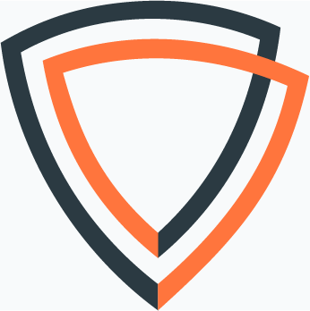

  <picture>
    <source media="(prefers-color-scheme: dark)" srcset="profile/AppThreat_Emblem_NoBorder_DarkTheme_v01_R01-01.png">
    
  </picture>

# AppThreat

We are a team of application security engineers who build open-source tools and help other teams put them to work through reviews, assessments, and training. One idea runs through everything we make: a security answer should carry its evidence with it. A list of component names, a warning about a library nobody calls, and a confident paragraph from a chat window are all opinions until someone can point at the code.

## The problem we work on

Software today is assembled more than it is written. A single release can carry hundreds of open-source packages, a container image, and compiled executables whose source is nowhere on the machine that ships them. Regulators, customers, and engineers then ask fair questions. What exactly is in this release? Which known weaknesses affect it? Is the library named in a vulnerability report actually called by our code, or is it dead weight we can retire? Most tooling answers with either a very long list or a very short guess, and both leave the real work to the reader.

Our tools answer with evidence. They describe software precisely, connect findings to the code paths that make them real, and produce documents that hold up in an audit.

## Where this is heading: chennai, atom, and chen

Our newer work asks how much of the gap between a theoretical finding and a real one can be closed.

[chen](https://github.com/AppThreat/chen) is a Scala library that represents a program as a single graph holding its syntax, its control flow, and the movement of data through it. A question such as "can input from a web request reach this command execution" becomes a traversal with an answer you can inspect, one that follows data across functions, files, and dependency boundaries and honors the validators that stand in the way. It began as a fork of Joern and has grown into an analysis core that reasons across the layers a real application is made of, from source and libraries to containers and the operating system underneath.

[atom](https://github.com/AppThreat/atom) is the tool built on chen. It turns a codebase written in Java, Python, JavaScript or TypeScript, PHP, Ruby, Scala, or C and C++ into one compact, queryable file, complete with call relationships, slices, and data flows. It already earns its keep in production: cdxgen uses atom to work out which dependencies a program actually uses, and to attach that evidence to the bills of materials it writes.

[chennai](https://github.com/AppThreat/chennai) is the newest piece, a terminal application that puts the whole picture in front of a person. Point it at a codebase or a binary and browse methods, calls, and data flows from the keyboard. Connect a language model and the same analysis becomes conversational, under one rule that matters: the agent is not allowed to guess. Every security finding it reports must be proven by a query and a data-flow path, and that proof is re-executed before the finding is accepted. A broad audit can be split into focused roles, from mapping entry points to proving flows to writing the report, and every claim in the result names a file and a line. chennai also reaches Rust, Go, and .NET through their own analyzers and examines compiled binaries through blint. All of it runs on your machine, and the model is optional: with no key configured, chennai is a fully offline analysis environment.

## The established toolchains

[cdxgen](https://github.com/cdxgen/cdxgen) is a complete software transparency toolchain, not merely a bill generator. It inventories applications, container images, and operating systems; writes CycloneDX bills of materials for components and for cryptography use; records known vulnerabilities in VEX documents; and can sign and attest its own output, so the inventory itself becomes evidence an auditor can verify. It works as a command, a library, a REPL, and a server, which is why it turns up everywhere from developer laptops to hardened build pipelines. Three companions keep it capable in the field. [cdxgen-plugins-bin](https://github.com/cdxgen/cdxgen-plugins-bin) bundles the analyzers that extend cdxgen into more languages and deeper questions: golem, rusi, and kosi are data-flow and reachability slicers for Go, Rust, and Kotlin that show which parts of a dependency a program actually exercises, while further plugins add Swift and .NET analysis and live inventory of hosts and containers. [caxa](https://github.com/cdxgen/caxa) packages Node.js applications such as cdxgen into single standalone executables, so the tool runs where Node does not, including locked-down build environments. [safer-exec](https://github.com/cdxgen/safer-exec) runs a command inside a sandbox and records what it opens, loads, and talks to, which is how cdxgen turns observed runtime behavior into a bill of materials rather than a declared one.

[blint](https://github.com/owasp-dep-scan/blint) is a toolchain for reverse engineers and for malware and security analysts who must judge a compiled program before running it. It reads ELF, PE, and Mach-O executables, WebAssembly modules, Android applications, and iOS bundles, and describes what they contain and what they are capable of, without ever executing them. It verifies code signatures and Windows driver posture, checks the protections applied at build time, reviews capabilities such as network access and cryptography use, disassembles functions of interest, and exports call graphs, alongside the CycloneDX inventory it produces for artifacts that have no package manifest to ask. Two projects widen its reach. [multi-demangle](https://github.com/AppThreat/multi-demangle) recovers readable function names from binaries built by a wide range of compilers and languages, from C++ and Rust to Swift, D, and Kotlin. [blint-db](https://github.com/AppThreat/blint-db) distills real builds of open-source projects into databases of symbols and fingerprints, so blint can recognize the components inside a stripped binary that carries no version string.

[dep-scan](https://github.com/owasp-dep-scan/dep-scan) audits dependencies for known vulnerabilities and license conflicts, in local projects and in container images, and sorts what it finds by risk. Its memory is [vulnerability-db](https://github.com/AppThreat/vulnerability-db), an offline database that merges advisories from NVD, OSV, GitHub, and the major Linux distributions into one searchable store kept in an open format. A scan runs with no network access, and the data belongs to whoever downloaded it.

[dosai](https://github.com/owasp-dep-scan/dosai) brings code-level evidence to .NET. From source, compiled assemblies, or NuGet packages, it recovers methods and call graphs, traces untrusted input to the operations that misuse it, inventories cryptographic use, and extracts API endpoints along with their authentication requirements. It is the bridge that lets the dependency view of dep-scan and the program view of atom describe the same application.

## How it fits together

The tools form a pipeline that follows software from commit to shipped artifact. cdxgen, blint, and dosai describe what a product contains, whether it is source, a container, or a binary. dep-scan, drawing on vulnerability-db, says what is known to be wrong with those contents. atom and chen establish what is actually reachable, which turns a long list of alerts into a short list of repairs. chennai hands the whole picture to an engineer in one place. Every stage speaks open formats, CycloneDX documents, CVE records, and package URLs, so the output stays useful to tools we did not write.

## Working with us

We take on custom tool development, architecture reviews and security assessments, product security risk work, and hands-on training in code analysis and secure coding. Write to hello@appthreat.com or visit [www.appthreat.com](https://www.appthreat.com/). If you run our tools at scale or build on top of them, we would like to hear what works for you and what does not.
